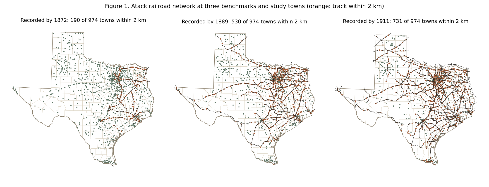
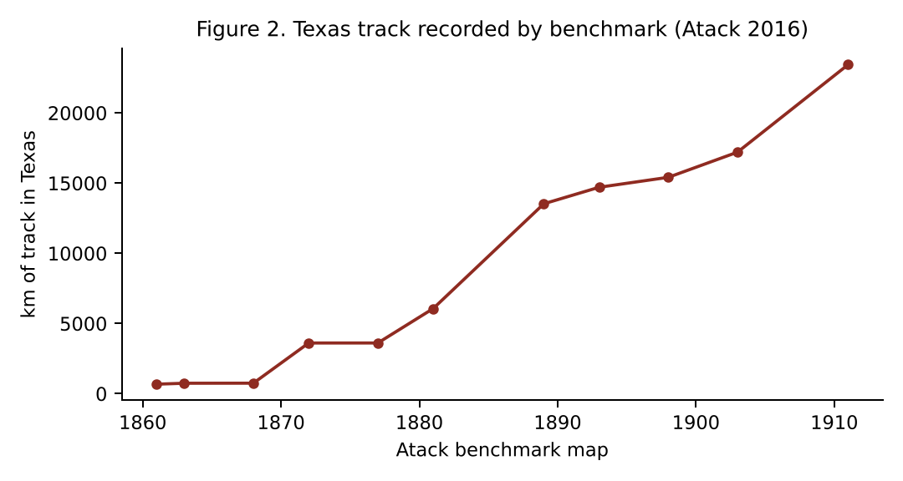
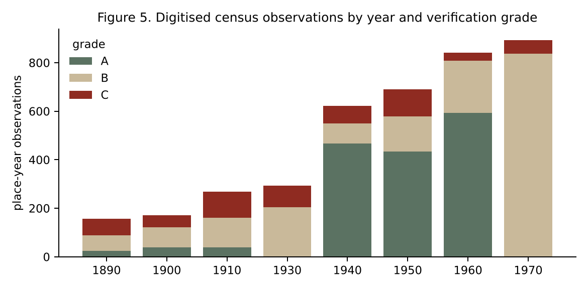
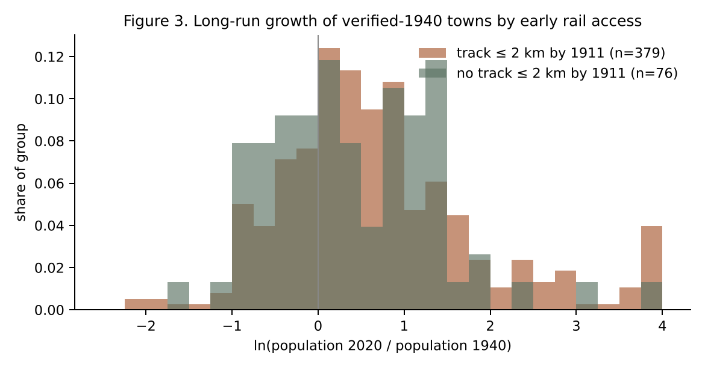
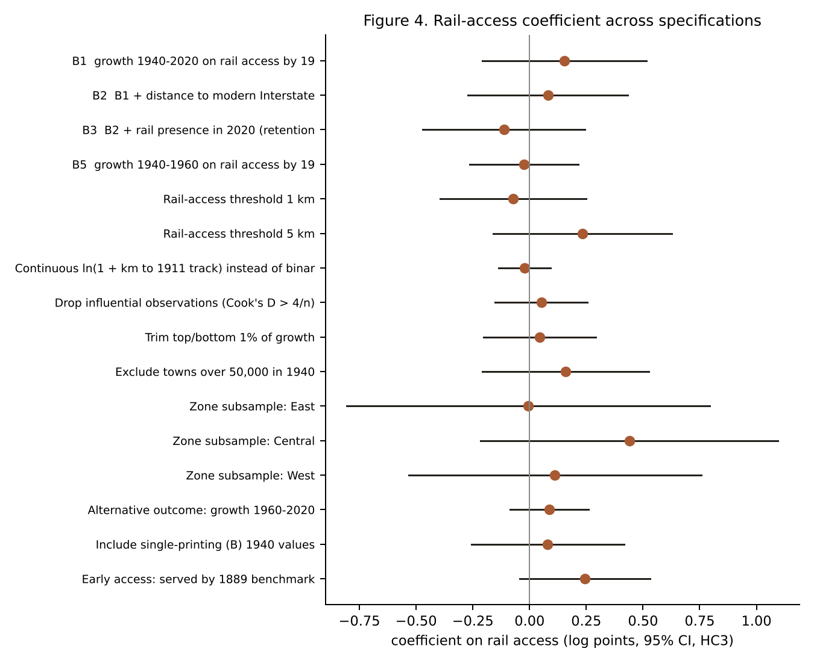
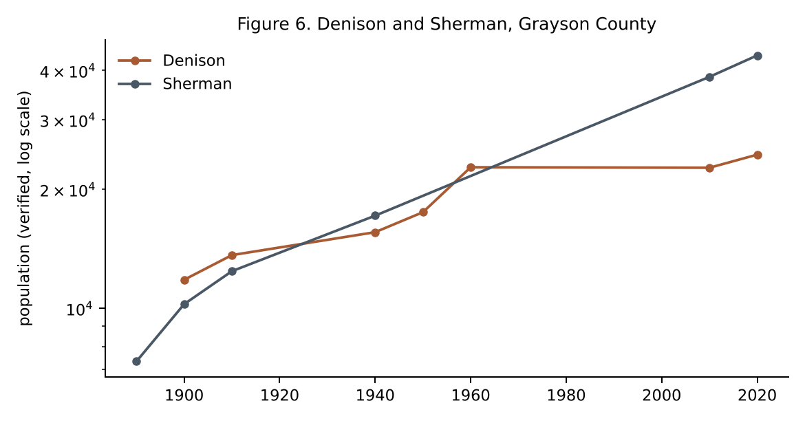

# Railroads and the Fate of American Towns: A Network-Based Analysis of Historical Population Change in Texas

*RailEffect project report — working paper, not peer reviewed. Generated by `pipeline/make_report.py`; every number below is read from the pipeline outputs.*

## Abstract

Did access to the railroad shape which Texas towns grew, declined or persisted? We link Jeremy Atack's historical railroad GIS (5,147 segments intersecting Texas across 11 benchmark maps, 1861–1911) to population counts for 974 incorporated places digitised from six U.S. Census volumes (1910–1970) with a multi-engine OCR pipeline and verified by agreement across independently printed volumes, plus official 2010 and 2020 counts. Towns within 2 km of track by 1911 grew 0.34 log points more between 1940 and 2020 than towns without track (95% CI 0.08 to 0.59). Conditional on 1940 population and a flexible geographic surface, the difference is 0.15 (95% CI [-0.21, 0.52]; n = 455), and the interval includes zero in 12 of 12 robustness specifications. Long-run growth is more closely associated with network distance to the cities that were already large in 1910 and with distance to the later Interstate system. A fixed-effects panel around rail arrival is uninformative because only 6 towns change rail status while they are enumerated. The evidence, in this sample of towns that had already incorporated, does not support a strong independent association between early rail access and mid- to late-twentieth-century growth; it is silent on settlements that never incorporated.

## 1. Research question

The question is whether railroad connectivity influenced the population trajectories of American towns, studied in Texas. Railroads plausibly lowered transport costs and concentrated commerce at stations; but towns also differed in initial size, location, agricultural hinterland and, later, highway access. The study is built to report a null or mixed result if the data give one.

## 2. Historical background (scope of claims)

Texas track grew from 676 km on Atack's 1861 benchmark to 6,063 km by 1881, 13,528 km by 1889 and 23,440 km by 1911 (Figure 2). This report does not narrate the histories of individual railroads or towns; it makes only claims supported by the datasets described below. Readers seeking narrative history are referred to the Handbook of Texas and the Portal to Texas History, which were not used as data.

## 3. Data sources

* **Railroads.** Atack, J. (2016), *Historical GIS database of U.S. railroads, 1826–1911* (file RR1826-1911Modified050916). Each segment carries the benchmark map on which it is first recorded (`InOpBy`). The author's download page was not reachable from the build environment; the identical layer (78,832 features, same schema) was read from a public ArcGIS Online copy. Modern rail features come from U.S. Census TIGER/Line 2020.
* **Population.** Incorporated-place tables from the 1910 (Table 2: 1890–1910), 1940 (Table 5: 1930–1940), 1950 (Table 7: 1940–1950), 1960 (Table 8: 1940–1960) and 1970 (Table 6: 1960–1970) census volumes for Texas, plus official 2010 and 2020 counts.
* **Locations.** USGS GNIS populated places (historic town points) and 2020 Census places; 2020 Interstate highways from TIGER primary roads.
* **Not used.** UNL *Railroads and the Making of Modern America* GIS and IPUMS NHGIS (not accessible from the build environment or requiring credentials); Texas State Library railroad maps (images, not digitised in this release).

## 4. Sampling and digitisation

The frame is every place printed as incorporated in any of the five tables. OCR place identities (1,535) were snapped to gazetteer spellings within their county; 974 matched a GNIS or Census point exactly and form the town set. Exclusions are listed with reasons in the published data.

Each table page was rendered at 500 dpi, deskewed, split into ruled columns, and each numeric column read by five OCR configurations. Values were assigned to rows by tracking each column's vertical drift. A count is **grade A** if the same number is read from two independently printed volumes, was checked visually against the page image (103 values for larger 1890–1910 towns), or is an official digital count; **grade B** if printed once with at least four of five readings agreeing; otherwise **grade C**. Models use grade A only. A random validation sample found grade A correct in 24/24 cases (95% CI 0.86–1.00) and grade B in 22/23 (0.78–1.00).

## 5. Network construction

Coordinates are projected to EPSG:3083. Segment endpoints within 150 m are merged into nodes; no other connections are made, so 100 map crossings inside Texas without a shared endpoint stay unconnected. Edges are weighted by length. For each benchmark the graph contains all segments recorded by that year. Towns within 2 km of track receive: network distance to the nearest 1910 city of 10,000+ (19 hubs), sampled betweenness, node degree and component membership.

## 6. Statistical approach

* **Model A** – descriptive comparison of log growth by rail status and arrival benchmark with bootstrap intervals.
* **Model B** – OLS of ln(pop₂₀₂₀/pop₁₉₄₀) on rail access by 1911, controlling for ln 1940 population, a quadratic in longitude/latitude and a three-zone regional effect, with HC3 and county-clustered errors; extensions add distance to the 2020 Interstate network, rail presence in 2020 and network position; a logit models persistence as a 2020 census place.
* **Model C** – a two-way fixed-effects panel for 1890–1910 around rail arrival, and a Mahalanobis nearest-neighbour match.

## 7. Results

**Descriptive.** Mean log growth 1940–2020 was 0.76 for rail-served towns (n = 379) and 0.42 for others (n = 76). By arrival benchmark: by 1872 1.10 (n = 89); 1873–1881 0.58; 1882–1889 0.76; 1890–1911 0.57. Earliest-served towns grew most; rail-served towns as a group were also larger in 1940 and located further east than unserved towns (see the matching balance in Section 7), so these differences are not adjusted comparisons (Figure 3).

**Regression.** Model B1: rail access by 1911 0.15 [-0.21, 0.52], p = 0.40 (clustered p = 0.38), R² = 0.12. Adding Interstate distance (B2) gives ln(1 + km to Interstate) -0.26 [-0.36, -0.17]. Rail presence in 2020 (B3) is associated with 0.50 [0.26, 0.75] higher growth — an association likely to run partly in reverse, since lines were abandoned where traffic fell. Among served towns (B4), ln network km to a 1910 hub has coefficient -0.33 [-0.50, -0.16]; sampled betweenness -4.43 [-7.60, -1.27]. For 1940–1960 (B5) the rail coefficient is -0.03 [-0.26, 0.21]. Persistence as a 2020 census place is near-universal, and the logit coefficient on rail access is -0.03 [-1.28, 1.22].

**Panel and matching.** The 1890–1910 panel contains 103 towns but only 6 change rail status; the estimate (0.2281; CI [-0.2151, 0.6713]) is reported for completeness and not interpreted. Nearest-neighbour matching gives 0.27 [0.1188, 0.4023], but the 76 potential controls differ markedly in location from the 379 served towns, so balance is poor.

## 8. Robustness

* Rail-access threshold 1 km: -0.07 [-0.39, 0.25], n = 455
* Rail-access threshold 5 km: 0.23 [-0.16, 0.63], n = 455
* Continuous ln(1 + km to 1911 track) instead of binary: -0.02 [-0.14, 0.09], n = 455
* Drop influential observations (Cook's D > 4/n): 0.05 [-0.15, 0.25], n = 437
* Trim top/bottom 1% of growth: 0.04 [-0.20, 0.29], n = 445
* Exclude towns over 50,000 in 1940: 0.16 [-0.21, 0.52], n = 449
* Zone subsample: East: -0.01 [-0.80, 0.79], n = 87
* Zone subsample: Central: 0.44 [-0.22, 1.09], n = 213
* Zone subsample: West: 0.11 [-0.53, 0.76], n = 155
* Alternative outcome: growth 1960-2020: 0.09 [-0.09, 0.26], n = 391
* Include single-printing (B) 1940 values: 0.08 [-0.26, 0.42], n = 526
* Early access: served by 1889 benchmark: 0.24 [-0.04, 0.53], n = 455

## 9. Historical interpretation

By 1911 about 75% of towns that would appear in mid-century census tables already lay within 2 km of track. Among these places, early rail access marks out a regional pattern — the earlier-settled east and centre against a later-settled west — more than it predicts which towns grew after 1940. Proximity to the cities that dominated the 1910 network, and to the highways built after 1956, is more strongly associated with later growth. This is consistent with railroads having mattered most at the stage this sample cannot see: whether a settlement became a town at all.

## 10. Limitations

1. Survivorship: only places that incorporated and were printed in census tables are observed.
2. OCR error remains possible even for verified values; validation intervals are wide because the sample is small.
3. Boundaries and annexations are not harmonised.
4. The network after 1911 is unobserved until 2020; abandonment timing is unknown.
5. Atack's lines come from small-scale maps; positional error matters for a 2 km threshold.
6. Controls are coarse (no agriculture, county-seat status, oil, highway timing).
7. Distance to Interstates is measured in 2020 and may respond to town size.

## 11. Conclusion

In this sample, the raw growth advantage of early rail towns is not distinguishable from zero once size and location are accounted for, while later network position and highway access are more strongly associated with growth. The result is an association in a selected population, not a causal estimate. Extending the frame to unincorporated settlements (for example through post-office records) and digitising post-1911 network snapshots are the most promising next steps.

## References

* Atack, Jeremy. 2016. *Historical Geographic Information Systems (GIS) database of U.S. Railroads* (RR1826-1911Modified050916). Vanderbilt University. Also archived as ICPSR 36353.
* U.S. Census Bureau. 1913. *Thirteenth Census of the United States: 1910. Vol. III, Population.* Texas, Table 2.
* U.S. Census Bureau. 1942. *Sixteenth Census of the United States: 1940. Population, Vol. I.* Texas, Table 5.
* U.S. Census Bureau. 1952. *Census of Population: 1950. Vol. I, Number of Inhabitants.* Texas, Table 7.
* U.S. Census Bureau. 1961. *Census of Population: 1960. Vol. I, Part 45, Texas.* Table 8.
* U.S. Census Bureau. 1973. *Census of Population: 1970. Vol. I, Part 45, Texas, Section 1.* Table 6.
* U.S. Census Bureau. 2011, 2021. 2010 Census counts (intercensal city file); 2020 Census Redistricting Data (P.L. 94-171).
* U.S. Census Bureau. TIGER/Line Shapefiles 2020: Rails; Primary Roads; Cartographic Boundary Files 2020.
* U.S. Geological Survey. Geographic Names Information System, Domestic Names (Texas).
